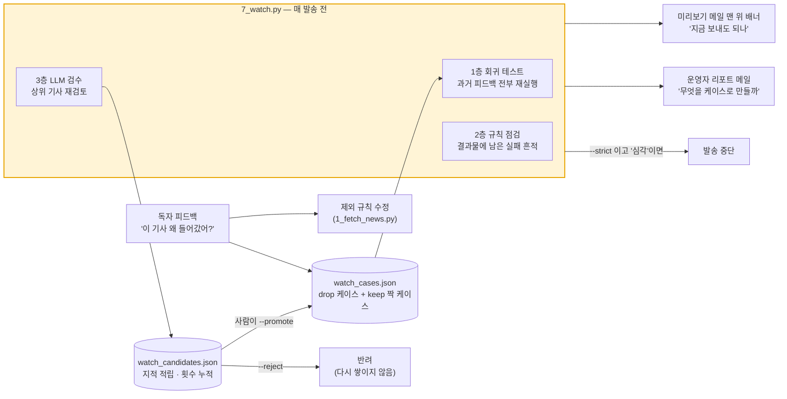
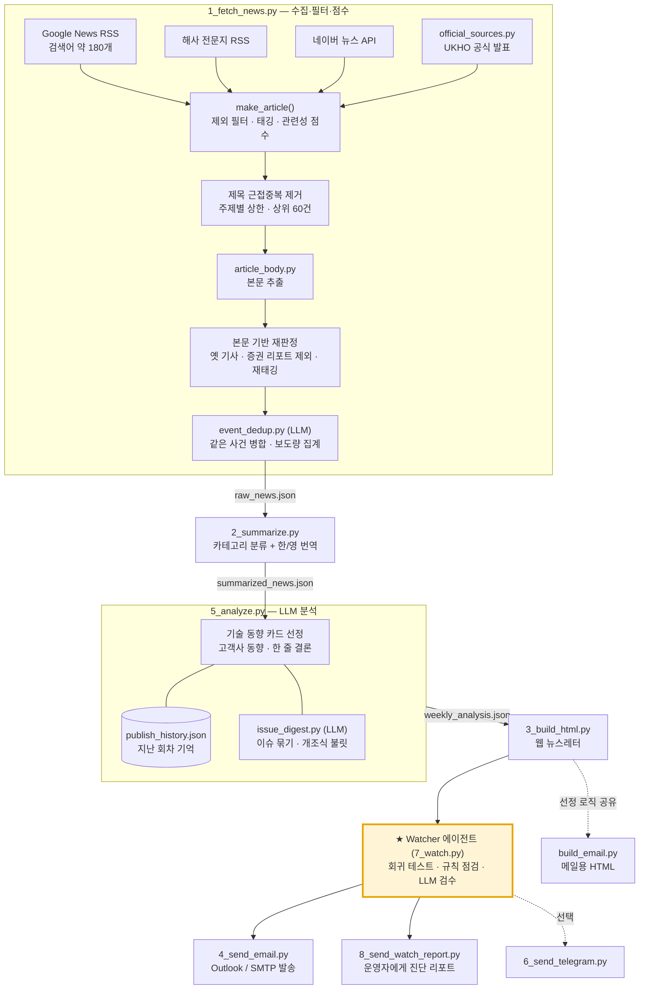

# News Briefing Pipeline

해사(海事)·해운·조선 뉴스를 매주 자동으로 모아 걸러 내고, LLM으로 분석해서 사내 브리핑 뉴스레터(웹 HTML + 메일)로 발송하는 파이프라인입니다.

핵심은 발송 직전에 도는 **[Watcher 에이전트](#watcher-에이전트--보내기-전에-스스로-검사한다)** 입니다. 사람이 매주 준 피드백을 회귀 테스트로 굳혀 두고, 결과물을 규칙과 LLM으로 다시 검사합니다. 문제가 있으면 사람에게 알리지만, 규칙을 스스로 고치지는 않습니다.

> A weekly maritime news briefing pipeline: collect → filter & score → translate → LLM analysis → HTML/email newsletter. Before anything is sent, a **Watcher agent** replays every past piece of reviewer feedback as a regression test, inspects the output for known failure traces, and has an LLM re-review the top stories. It reports; it never rewrites its own rules.

> **익명화 안내**: 실제 회사에서 운영하던 코드를 공개용으로 정리한 버전입니다. 회사명(`아크메` / Acme Marine), 제품명(`FleetHub`), 일부 고객사(`예시해운1` 등)와 국내 경쟁사(`경쟁사1`~`경쟁사9`)는 가명으로 바꿨습니다. 주석에 남은 날짜와 '실측' 기록은 실제 운영 중에 내린 결정의 근거입니다.

---

## 무엇을 하나

매주 한 번 실행하면 다음 결과물이 나옵니다.

| 산출물 | 내용 |
|---|---|
| `weekly_newsletter_YYYYMMDD.html` | 웹 브라우저용 뉴스레터. 기술 동향 TOP 카드, 고객사·경쟁사·규제 동향, 카테고리별 이슈 목록(접기/펼치기), 한/영 전환 |
| `weekly_email_YYYYMMDD.html` | Outlook·Gmail에서 깨지지 않는 메일 본문용 HTML(table 레이아웃, 인라인 스타일) |
| `watch_report_YYYYMMDD.md` | 발송 전 자가진단 리포트(회귀 테스트·규칙 점검·LLM 검수 결과) |

뉴스레터의 섹션 구성은 이렇습니다.

1. **이번 주 한 줄 결론**: LLM이 이번 주 핵심을 한 문장으로 정리
2. **기술 동향 TOP 카드** (2~4장): 자사 사업에 의미 있는 기사 + 개조식 요약 + "의의 및 시사점"
3. **고객사 동향**: 해운사·조선소별 1건씩
4. **컴플라이언스**: IMO·선급·EU 규제, 수로국(UKHO) 공식 발표
5. **경쟁사 동향**: 업체별 1건씩
6. **카테고리별 전체 뉴스**: AI·자율운항 / 신조·조선 / 탈탄소 / 해운시황 / 기타. 이슈 한 줄 아래에 기사를 접어 둠

---

## Watcher 에이전트 — 보내기 전에 스스로 검사한다

`7_watch.py` · `watch_cases.json` · `8_send_watch_report.py`

뉴스 선별 규칙은 매주 독자 피드백을 받아 조금씩 고쳐집니다("이 기사는 왜 들어갔어?", "이건 왜 빠졌어?"). 그렇게 몇 달을 운영하면서 문제는 세 가지 방식으로, 전부 **조용히** 터졌습니다.

| 문제 | 실제로 있었던 일 |
|---|---|
| **고친 문제가 되살아난다** | 고친 이유는 소스 주석에 남았지만 주석은 실행되지 않습니다. 키워드 하나를 넓히면 예전에 막은 기사가 돌아오거나, 멀쩡한 기사가 함께 사라졌습니다. |
| **단계가 실패해도 아무도 모른다** | 사건 병합 LLM이 할당량에 걸려 통째로 실패했는데, 로그에 한 줄만 남고 파이프라인은 정상 종료했습니다. 같은 LPG선 수주 기사 3건이 그대로 발송됐습니다. 다른 주에는 무료 번역이 차단되어 기사 50건이 원문 그대로 나갔습니다. |
| **찾아도 전달이 안 된다** | LLM 검수가 문제 기사를 짚었지만 리포트에 '참고' 한 줄로 남고 다음 주에는 사라졌습니다. |

Watcher는 이 셋을 한 겹씩 맡는 **세 겹 구조**입니다.



### 세 겹 검사

| 층 | 하는 일 | 무엇을 잡나 |
|---|---|---|
| **1층 회귀 테스트** | `watch_cases.json`의 케이스(현재 105건: drop 56 · keep 49)를 수집 단계의 판정 함수 `make_article()`에 매번 다시 통과시킵니다 | `drop`: 지적받은 기사가 다시 통과하는지<br/>`keep`: 규칙이 너무 넓어져 멀쩡한 기사가 사라지는지 |
| **2층 규칙 점검** | 결과물을 읽고, 이미 겪어 본 실패의 흔적을 기계적으로 찾습니다 | 사건 요약 0건(병합 단계 실패), 국문 제목이 영어(번역 실패), 본문 확보율 60% 미만, 같은 주체·같은 금액 중복, 제목에 해사 어휘가 없는 기사, 이미 지적받은 노이즈 유형 통과, 한 주제가 상위 카드를 독식, 자사 기사 누락 |
| **3층 LLM 검수** (`--llm`) | 점수 상위 40건을 모델이 다시 읽고, 확신하는 문제만 최대 5건 지적합니다 | `무관`(해사 뉴스가 아님), `중복`, `홍보`(행사·수상·인사), `사내`(복지·사옥·주가) |

`keep` 케이스가 이 구조의 핵심입니다. 제외 규칙을 새로 만들 때는 그 규칙이 **걸면 안 되는 기사**를 짝으로 함께 넣습니다.

| 막으려던 것 | 함께 넣은 `keep` 짝 | 무엇을 지키나 |
|---|---|---|
| 노사 기사(`union`) | EU 규제 기사 | 'European **Union**'이 함께 사라지지 않게 |
| 채용 기사(`채용`) | "메탄올 엔진 **채용** 컨테이너선 인도" | '채택'이라는 뜻의 '채용'은 해사 기사에 흔함 |
| 노조 농성(`sit-in`) | "boxships **sit in** queue at Busan" | 선박 대기 기사가 걸리지 않게 |

규칙이 지나치게 넓어지는 순간 이 케이스들이 실패합니다.

### 설계 결정

- **보고만 하고, 규칙은 고치지 않는다.** 키워드 목록은 왜 그 단어를 넣고 뺐는지가 주석으로 남아 있는 문서입니다. 에이전트가 조용히 고쳐 쓰면 그 기록이 깨집니다. Watcher가 스스로 쓰는 파일은 대기 목록(`watch_candidates.json`) 하나뿐이고, 이 파일은 아무 효력이 없습니다.
- **LLM의 지적은 자동으로 테스트가 되지 않는다.** 첫 버전은 40건 중 25건을 지적했습니다. 오탐이 회귀 케이스에 섞이면 사람이 그 오답에 맞춰 키워드를 고치게 됩니다. 그래서 지적은 대기 목록에 쌓아 회차마다 횟수를 셉니다. **두 회차 이상 지적된 기사**만 '주의'로 올려 배너에 노출합니다. 케이스로 승격하는 것은 사람이 `--promote`로 합니다.
- **정밀도가 재현율보다 중요하다.** 오탐이 쌓이면 사람이 리포트를 읽지 않습니다. LLM 프롬프트는 "이건 정상이니 지적하지 말라"(수주·인도·규제·경쟁사 소식)를 먼저 못박고, 지적은 5건으로 제한합니다. 2층의 중복 점검도 오탐이 거의 없는 두 신호(같은 주체 + 같은 금액, 사실상 같은 사건 요약)만 씁니다.
- **사람의 결론과 LLM이 부딪히면 프롬프트를 의심한다.** 사람이 `keep`으로 확정한 기사를 LLM이 지적하면, 적립하지 않고 'LLM 오탐 의심' 경고를 냅니다.
- **실패의 무게를 구분한다.** 회귀 실패("예전에 고친 게 되살아났다")는 '심각'입니다. 승격은 됐지만 아직 거를 규칙이 없는 케이스(`"todo": true`)는 실패해도 '주의'입니다. 사람의 할 일 목록 때문에 발송이 막히면 '심각'이라는 신호가 흐려집니다.
- **기본은 경고만 한다.** 진단이 틀려서 뉴스레터가 안 나가는 것이 더 나쁩니다. `--strict`(내부적으로 `--block`)를 주면 '심각' 항목에서 발송을 멈춥니다.
- **받는 사람에 맞게 두 갈래로 보낸다.** 미리보기 메일 맨 위 배너는 "지금 보내도 되나"를 빠르게 판단하는 용도라 짧게 씁니다. 운영자 리포트(`8_send_watch_report.py`)는 "무엇을 케이스로 만들까"를 판단하는 용도라 근거·링크·명령어를 다 붙입니다. 두 판단은 시한이 달라서, 한 곳에 넣으면 둘 다 읽히지 않습니다.

### 사용법

```bash
python 7_watch.py                     # 1·2층 (LLM 없음, 무료)
python 7_watch.py --llm               # + 3층 LLM 검수 (지적을 대기 목록에 적립)
python 7_watch.py --llm --block       # '심각'이면 exit 1 (발송 중단용)

python 7_watch.py --candidates        # 쌓인 지적 보기
python 7_watch.py --promote 3         # 3번을 watch_cases.json 케이스로 승격
python 7_watch.py --reject 3          # 3번을 반려 (다시 쌓이지 않음)
```

`run_all.py`는 기본으로 `--llm`을 붙여 Watcher를 실행합니다. `--strict`를 주면 `--block`이 붙습니다.

---

## 파이프라인 구조



`run_all.py`가 `1 → 2 → 5 → 3 → 7 → (4, 6)` 순서로 실행합니다. 단계마다 기대한 출력 파일이 **이번 실행에서 새로 갱신됐는지** 확인하고, 아니면 그 자리에서 멈춥니다. 앞 단계가 조용히 실패했는데 지난주 파일로 뉴스레터가 나가는 사고를 막기 위해서입니다. 스크립트 번호가 실행 순서와 다른 것은 단계를 나중에 끼워 넣은 흔적입니다.

### 1단계 — 수집·필터·점수 (`1_fetch_news.py`)

파이프라인에서 가장 큰 모듈이고, 뉴스레터 품질 대부분이 여기서 결정됩니다.

**수집.** Google News RSS 검색어를 주제(자율운항·S-100·탈탄소 규제…)와 회사(고객사·조선소·경쟁사) 단위로 넓게 둡니다. 거기에 해사 전문지 RSS, 네이버 뉴스 API, 규제기관 공식 발표를 더합니다. 구글과 네이버는 검색 한 번에 최대 100건만 주기 때문에, 기사량이 많은 회사명은 단독 검색만으로 7일 창 전체를 덮지 못합니다. 그래서 `HMM AI`, `한화오션 자율운항`처럼 주제어를 붙인 좁은 검색어를 함께 돌립니다. 구글 검색어에는 `when:7d`를 붙여 서버 단계에서 옛 기사를 거릅니다.

**제외 필터** (`make_article()`). 기사 한 건마다 "실을 가치가 없는 유형"인지 먼저 판정합니다. 주가·증권, 인사·부고, 행사·전시·수상, 채용, 노사·임금, 기부, 지자체 특구·센터 개소, 의학 기사(검색어 'S-100'에 'S100 단백'이 걸리는 경우) 등이 대상이고, 대부분 **제목 기준**으로 판정합니다. 본문에는 스치듯 지나가는 단어가 많아 오탐이 나기 때문입니다. 마지막으로 제목에 해사 어휘가 하나도 없으면 주제 밖 기사로 보고 버립니다(제목 해사 게이트).

**태깅.** 고객사·경쟁사·자사·컴플라이언스 태그를 붙입니다. 회사 태그는 제목으로만 감지합니다. 본문에 회사명이 한 번 스쳤다고 그 회사 기사가 되지는 않습니다.

**관련성 점수** (`relevance_score()`). 상위 60건만 남기기 때문에 점수의 변별력이 핵심입니다.
- 주체: 고객사 +6, 관련사 +3
- 제품 밀착도(점수의 주축): 핵심어 종류당 +5(최대 3종), 인접어 종류당 +2(최대 3종). 동의어 묶음(북극항로 계열 11개 등)은 한 종류로 셉니다.
- 일반 해사 키워드: 최대 +2. "해사 기사인지" 확인하는 최소 신호입니다.
- AI 결합: AI 신호어와 적용 대상(스마트십·선박관리·항로 최적화…)이 함께 있을 때만 +4
- 최신성: +1 ~ +3
- 감점: 사내소식 -4, 행사·홍보 -5, 증권가 분석 -3

키워드 매칭은 `keyword_match.py`가 맡습니다. 짧은 영문 약어(`ai`, `imo`, `one`)에는 단어 경계를 적용합니다(`hyundai`의 `ai`가 걸리지 않게). 한국어에는 조사 때문에 경계를 적용하지 않습니다.

**중복 정리.** 단계마다 성격이 다른 중복을 맡습니다.
1. 제목 토큰 근접중복: 같은 기사의 매체별 재전송
2. 본문 수집 후 `event_dedup.py`: LLM이 기사를 "사건 한 줄"로 요약하고, 그 요약끼리 비교해 같은 사건을 하나로 합칩니다. 제목·본문 유사도로는 "같은 사건"과 "같은 주제 다른 각도"가 같은 구간에 겹쳐 임계값 하나로 가를 수 없었기 때문입니다. 합칠 때 몇 개 매체가 다뤘는지(coverage)를 세어 점수에 반영합니다.

LLM 단계는 실패해도 원본을 그대로 넘깁니다. 중복 정리는 품질 개선이지 필수 단계가 아니라서, 여기서 파이프라인이 멈추면 안 됩니다.

### 2단계 — 분류·번역 (`2_summarize.py`)

키워드 규칙으로 카테고리(AI·자율운항 / 신조·조선 / 탈탄소 / 해운시황 / 기타)를 정합니다. 제목과 요약은 한국어·영어 양쪽으로 만듭니다. 무료 Google 번역을 먼저 쓰고, 막히면 Gemini로 넘어갑니다. 번역 결과에 섞여 들어오는 한자·가나는 걸러 냅니다.

**번역 후 재판정.** 1단계의 제외 필터는 원제목으로 판정하는데, 제외 어휘 목록은 한국어 쪽이 훨씬 촘촘합니다. 그래서 영문 기사는 번역이 끝난 뒤 한국어 제목으로 제외 규칙을 한 번 더 적용합니다(`drop_translated_noise()`). 실제로 영문 노조 농성 기사("Union Leader Launches Crane Sit-in…")가 원제목 판정을 통과했다가, 번역된 제목("…노조 위원장 크레인 고공 농성 돌입")에서 걸렸습니다. 이 단계가 `summarized_news.json`을 쓰므로 분석·카드·전체 뉴스·메일 모두 이 결과를 따릅니다.

### 3단계 — LLM 분석 (`5_analyze.py`)

Gemini가 이번 주 기사 전체를 읽고 **기술 동향 카드**, **고객사 동향**, **한 줄 결론**을 만듭니다. 환각을 막는 장치가 여럿 있습니다.

- **모델은 기사를 `[id]`로만 지칭합니다.** 제목·링크·출처 같은 사실 필드는 모델 출력이 아니라 수집 데이터에서 id로 병합합니다. 모델이 링크를 지어낼 수 없습니다.
- **응답 스키마를 강제합니다**(Gemini `responseSchema`). JSON이 잘리거나 깨질 수 없습니다.
- **프롬프트에 회사 컨텍스트가 있습니다**(`COMPANY_CONTEXT`). 사업 영역뿐 아니라 "우리가 하지 *않는* 일" 목록이 함께 들어갑니다. 대학의 파고 예측 연구 기사를 보고 "우리 예측 모델 상용화가 지연되면…"처럼 없는 개발 과제를 지어내던 문제를 막기 위해 넣었습니다.
- **문체·과장 규칙**: 상투어("기회가 될 수 있습니다")와 과장 표현("급증", "폭발적")을 금지합니다. 발표·시연을 "공급·수주"로 바꿔 쓰는 것도 금지합니다.

카드 선정에는 모델 판단 위에 코드가 정하는 규칙이 얹힙니다.
- **후보 우선순위**: 자사 기사 → 핵심 사업(북극항로·빙해 항행) 대표 1건 → 점수순
- **연속 게재 상한**: 특정 주제가 몇 주 연속 TOP을 차지하면 한 회차 쉬어 갑니다. 지난 회차에 무엇을 실었는지는 `publish_history.py`가 기억합니다.
- **행사 쏠림 상한**: 같은 전시회 기사가 다른 섹션에 이미 많으면 기술 동향에서 뺍니다.
- **기술 동향 후보 제외어**: 기업 IR성 사업확장 기사, 업무협약(MOU) 발표, 인물 동정, 부동산 기사 등. 제목·요약뿐 아니라 1단계에서 만든 사건 요약까지 봅니다. 제목엔 '협력'이라고만 쓰고 실제로는 협약 체결인 기사가 있기 때문입니다. 전체 뉴스 목록에는 그대로 남습니다.
- **빈자리 채우기는 최소한으로**: 위 규칙들로 모델이 고른 카드가 빠지면, 2장이 안 될 때만 다음 후보로 채웁니다. 홀수로 남으면 모델 순위가 가장 낮은 카드를 빼서 2열 그리드를 맞춥니다. 코드가 채운 카드에는 모델의 시사점이 없으므로, 할당량을 채우려고 약한 카드를 넣지 않습니다.

`issue_digest.py`는 카테고리 안의 기사를 "이슈" 단위로 묶고, 기사마다 2~3줄 개조식 불릿 요약을 만듭니다. 본문을 붙이기 시작하면서 카드가 200자 통문장이 되어 읽히지 않는다는 피드백이 있었고, 그 대응으로 만든 모듈입니다.

### 4단계 — 렌더링 (`3_build_html.py`, `build_email.py`)

웹용과 메일용은 렌더링 방식이 다릅니다. 웹은 CSS 그리드와 JS 토글을 쓰고, 메일은 Outlook의 Word 렌더링 엔진에서도 깨지지 않도록 table 레이아웃과 인라인 스타일만 씁니다. 반면 **"무엇을 싣는가"는 한 곳에서 정합니다.** 두 빌더가 선정 로직을 각자 갖고 있던 시절에는 같은 데이터로 만들어도 웹 38건, 메일 56건으로 갈렸습니다. 지금은 `build_email.py`가 `3_build_html.py`의 선정 함수(`section_lists()`)를 그대로 가져다 씁니다.

고객사·경쟁사·컴플라이언스 카드는 LLM이 아니라 **결정론적 규칙**으로 고릅니다(업체당 1건, 점수순, 비조선 사업부문·선급 보도자료 제외 등).

### 5단계 — Watcher 에이전트 (`7_watch.py`)

렌더링이 끝나면 발송 전에 Watcher가 결과물을 검사합니다. 세 겹 구조와 설계 결정은 위의 **[Watcher 에이전트](#watcher-에이전트--보내기-전에-스스로-검사한다)** 섹션에 정리했습니다.

### 발송 (`4_send_email.py`, `6_send_telegram.py`)

- Outlook 데스크톱(`--outlook`, pywin32) 또는 SMTP 두 경로를 지원합니다.
- `--require-today`: 오늘 만든 뉴스레터가 아니면 보내지 않습니다. 앞선 빌드가 실패했을 때 지난주 파일이 나가는 것을 막습니다.
- 텔레그램은 요약 + HTML 첨부를 보내는 선택 기능입니다.

---

## 설계 원칙

코드 곳곳의 주석에 반복해서 나오는 원칙입니다.

- **실패해도 멈추지 않는 단계와 멈춰야 하는 단계를 나눈다.** LLM 중복 병합·이슈 요약·행사 상한은 실패하면 건너뜁니다. 수집·분석 결과 파일이 갱신되지 않았으면 전체를 멈춥니다.
- **판정은 제목으로, 근거는 본문으로.** 본문은 스치는 단어가 많아 제외·태깅 판정에 쓰면 오탐이 납니다. 본문은 LLM이 읽을 근거와 "옛 기사 재색인" 같은 명백한 신호에만 씁니다.
- **우선순위는 예외 규칙이 아니라 점수로 표현한다.** 특정 주제에 고정 슬롯을 떼어 주는 대신 핵심어 가중치를 조정합니다. 같은 주제를 동의어로 반복해 점수를 버는 것은 막습니다.
- **모든 규칙 변경에는 실측과 짝 케이스를 남긴다.** 새 제외어를 넣을 때는 그 단어가 걸면 안 되는 정상 기사를 `keep` 케이스로 함께 넣습니다(예: '채용'을 막으면 "메탄올 엔진 **채용**"이 걸린다).

---

## 실행

```bash
python -m pip install -r requirements.txt
cp .env.example .env          # GEMINI_API_KEY 등 채우기

python run_all.py             # 수집 → 번역 → 분석 → HTML → 자가진단
python run_all.py --send      # + 메일 발송
python run_all.py --strict    # 자가진단 '심각' 시 중단
python build_email.py         # 메일용 HTML만 다시 만들기

python 7_watch.py --candidates        # LLM 검수 지적 대기 목록
python 7_watch.py --promote 3         # 3번 지적을 회귀 케이스로 승격
```

### 필요한 것
- Python 3.10+
- Gemini API 키 (필수: 사건 병합·분석·이슈 요약·LLM 검수)
- 네이버 검색 API 키 (선택: 없으면 네이버 수집만 건너뜀)
- SMTP 계정 또는 Outlook 데스크톱 (발송 시)

### 자기 회사에 맞게 바꾸려면
1. `5_analyze.py`의 `COMPANY_CONTEXT`: 회사 소개, 사업 영역, "하지 않는 일", 관심 우선순위
2. `1_fetch_news.py`의 검색어(`GOOGLE_QUERIES_*`), 회사 감지 규칙(`CUSTOMER_RULES`, 경쟁사 목록, `OWN_COMPANY_KEYWORDS`), 관련성 키워드(`CORE_RELEVANCE_KEYWORDS` 등)
3. `3_build_html.py` 상단의 회사명·로고 문구
4. `watch_cases.json`의 회귀 케이스는 이 설정 기준으로 쓰여 있습니다. 설정을 크게 바꾸면 일부가 실패할 수 있습니다.

운영 환경에서는 Windows 작업 스케줄러로 매주 월요일 07:45에 빌드하고 운영자에게 미리보기를 보낸 뒤, 09:00에 같은 파일을 팀에 발송하는 2단 구성으로 돌렸습니다. 그 사이에 운영자가 자가진단 배너를 보고 발송 여부를 판단합니다.

---

## 파일 구성

| 파일 | 역할 |
|---|---|
| `run_all.py` | 전체 파이프라인 실행기 |
| `1_fetch_news.py` | 수집 · 제외 필터 · 태깅 · 관련성 점수 · 상한 |
| `official_sources.py` | 규제기관·수로국 공식 발표 직접 수집 |
| `article_body.py` | 기사 본문 추출, 본문 기반 옛 기사 판정 |
| `event_dedup.py` | LLM 사건 요약 기반 같은 사건 병합 |
| `keyword_match.py` | 키워드 매칭 유틸(단어 경계, 따옴표·코너명 처리, 중복 판정 토큰) |
| `2_summarize.py` | 카테고리 분류 · 한/영 번역 |
| `5_analyze.py` | LLM 분석 · 카드 선정 규칙 |
| `issue_digest.py` | 이슈 묶기 · 개조식 불릿 요약 |
| `publish_history.py` | 지난 회차 게재 기록(연속 게재 상한용) |
| `gemini_client.py` | Gemini 호출 공용 모듈(스키마 강제, 재시도) |
| `groq_throttle.py` | (구) Groq 분당 토큰 한도 페이서. Gemini 전환 전 사용 |
| `3_build_html.py` | 웹 뉴스레터 HTML · 섹션 선정 로직 |
| `build_email.py` | 메일 클라이언트 호환 HTML |
| `7_watch.py` | 발송 전 자가진단 |
| `watch_cases.json` | 회귀 테스트 케이스(과거 피드백) |
| `8_send_watch_report.py` | 운영자용 진단 리포트 메일 |
| `4_send_email.py` | Outlook / SMTP 발송 |
| `6_send_telegram.py` | 텔레그램 전송(선택) |
