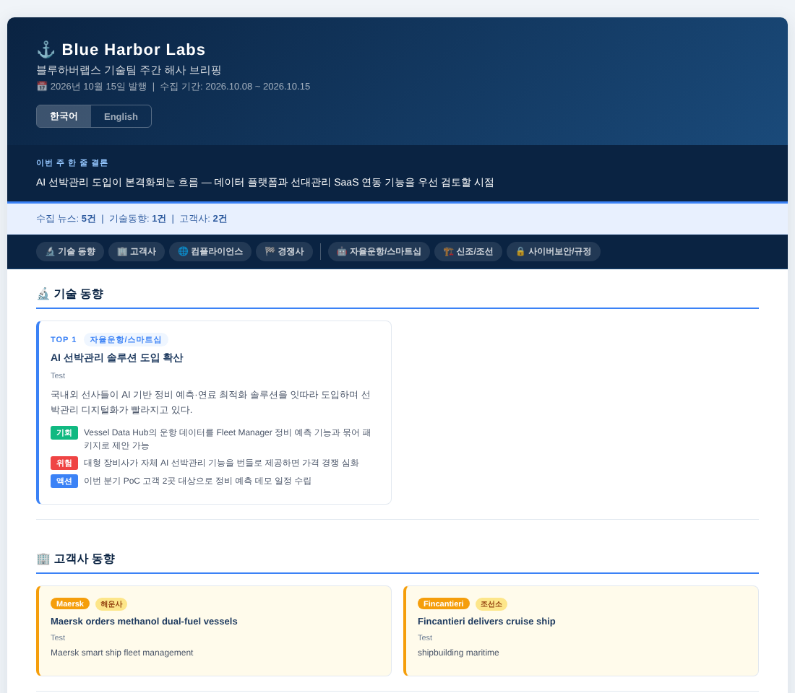

# 📰 Weekly Industry News Briefing

업계 뉴스를 매주 자동으로 모으고, 우리 회사 입장에서 LLM이 분석해서
**한/영 HTML 뉴스레터**를 만들고 이메일·텔레그램으로 보내는 파이썬 파이프라인입니다.

회사 이름, 소개, 검색어, 고객사, 경쟁사는 모두 `profile.json` 하나에 들어 있어요.
코드는 그대로 두고 이 파일만 바꾸면 어느 업계에서든 쓸 수 있습니다.
(예시 프로필은 가상의 해양 소프트웨어 회사 "Blue Harbor Labs" 기준이에요.)



## 주요 기능

- **수집**: RSS 피드, Google News 검색(한/영), 네이버 검색 API에서 최근 7일 뉴스를 모읍니다
- **태깅·점수**: 고객사 / 경쟁사 / 규제 기사를 자동으로 분류하고, 키워드 가중치로 관련성 점수를 매깁니다
- **중복 제거**: 제목 문자 바이그램 유사도(overlap·Jaccard)로 같은 사건을 다룬 다른 헤드라인을 하나로 합칩니다
- **번역**: 모든 기사에 한국어·영어 제목과 요약을 채웁니다 (무료 Google 번역)
- **LLM 분석**: Groq(Llama 3.3 70B)가 기사마다 기회 / 위험 / 후속 액션을 한·영으로 작성합니다
  - LLM은 기사를 `[id]`로만 고르고, 제목·링크·출처는 원본 데이터에서 다시 합칩니다. **링크를 지어내는 환각을 막기 위해서예요**
  - 태깅된 기사가 기술 동향에 섞이지 않도록 코드에서 한 번 더 걸러냅니다
  - 응답에 섞인 한자·가나 문자는 지웁니다
- **출력**
  - 웹 버전 HTML: 주제 바로가기, 한/영 전환 토글
  - 이메일 버전 HTML: 테이블 레이아웃과 인라인 스타일을 써서 Outlook에서도 깨지지 않습니다
- **발송**: SMTP, Outlook 데스크톱(초안 열기 또는 바로 발송), 텔레그램 요약 + HTML 첨부
- **자동화**: `weekly_send.bat`를 Windows 작업 스케줄러에 등록하면 매주 자동으로 실행됩니다

## 파이프라인

```
1_fetch_news.py  ──▶ raw_news.json            수집 · 필터 · 태깅 · 점수 · 중복 제거
2_summarize.py   ──▶ summarized_news.json     카테고리 분류 · 한/영 번역
5_analyze.py     ──▶ weekly_analysis.json     LLM 분석 (기회/위험/액션, 한 줄 결론)
3_build_html.py  ──▶ weekly_newsletter_*.html 웹 버전
build_email.py   ──▶ weekly_email_*.html      이메일 호환 버전
4_send_email.py / 6_send_telegram.py          발송
```

`run_all.py`가 위 단계를 차례로 실행합니다. 어떤 단계가 실패하거나 결과 파일이 새로 만들어지지 않으면 거기서 멈춥니다.

## 빠른 시작

```bash
pip install -r requirements.txt

cp .env.example .env                    # GROQ_API_KEY 등 입력
cp profile.example.json profile.json    # 내 회사/팀에 맞게 수정 (선택)

python run_all.py                       # 수집 → 번역 → 분석 → HTML 생성
python run_all.py --send                # + SMTP 이메일 발송
python run_all.py --telegram            # + 텔레그램 전송
```

`profile.json`이 없으면 `profile.example.json`을 씁니다.

## 프로필 설정 (`profile.json`)

| 키 | 설명 |
|---|---|
| `brand` | 팀 이름, 로고 텍스트, 브리핑 제목, 문의처 |
| `company_context` | LLM에게 주는 회사 소개 (제품, 관심 영역, 우선순위) |
| `analysis_rules` | 기술 동향을 고를 때 추가로 지킬 규칙 |
| `sources` | 고정 RSS 피드 목록 |
| `queries` | Google News·네이버 검색어 (주제 / 규제 / 경쟁사, 한·영) |
| `keywords` | 수집 필터, 핵심어(+3)·인접어(+2)·일반어(+1), AI 결합 보너스, 제외어, 규제 키워드 |
| `customers` | 고객사 이름, 영문 표기, 그룹(배지), 감지 키워드 |
| `competitors` | 경쟁사 이름, 감지 키워드 |

`profile.json`과 `.env`는 `.gitignore`에 들어 있어서 실제 회사 정보나 키가 커밋되지 않습니다.

## 환경 변수 (`.env`)

| 변수 | 필수 | 용도 |
|---|---|---|
| `GROQ_API_KEY` | ✅ | LLM 분석 |
| `EMAIL_RECIPIENTS` | 발송 시 | 수신자 (쉼표로 구분) |
| `SMTP_HOST` / `SMTP_PORT` / `SMTP_USER` / `SMTP_PASSWORD` | SMTP 발송 시 | Gmail은 앱 비밀번호 사용 |
| `TELEGRAM_BOT_TOKEN` / `TELEGRAM_CHAT_ID` | 선택 | 텔레그램 전송 (`python 6_send_telegram.py --getid`로 chat_id 확인) |
| `NAVER_CLIENT_ID` / `NAVER_CLIENT_SECRET` | 선택 | 네이버 뉴스 수집 (없으면 건너뜀) |
| `PROFILE_PATH` | 선택 | 다른 프로필 파일 경로 |

## 발송 옵션

```bash
python 4_send_email.py                 # SMTP DRY RUN (미리보기)
python 4_send_email.py --yes           # SMTP 실제 발송
python 4_send_email.py --outlook       # Outlook 초안 열기 (Windows, pywin32)
python 4_send_email.py --outlook --yes # Outlook 바로 발송
```

## 기술 스택

Python 3.10+ · feedparser · requests · deep-translator · Groq API (Llama 3.3 70B) · HTML/CSS · pywin32 (Outlook)
